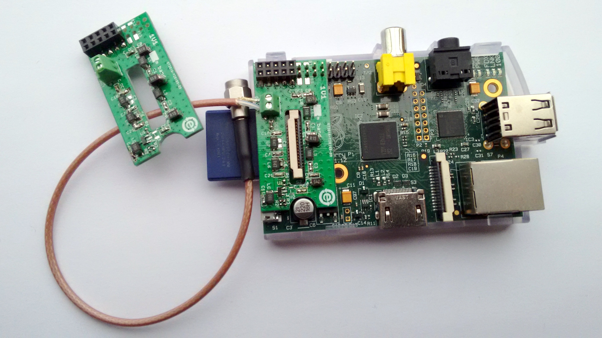
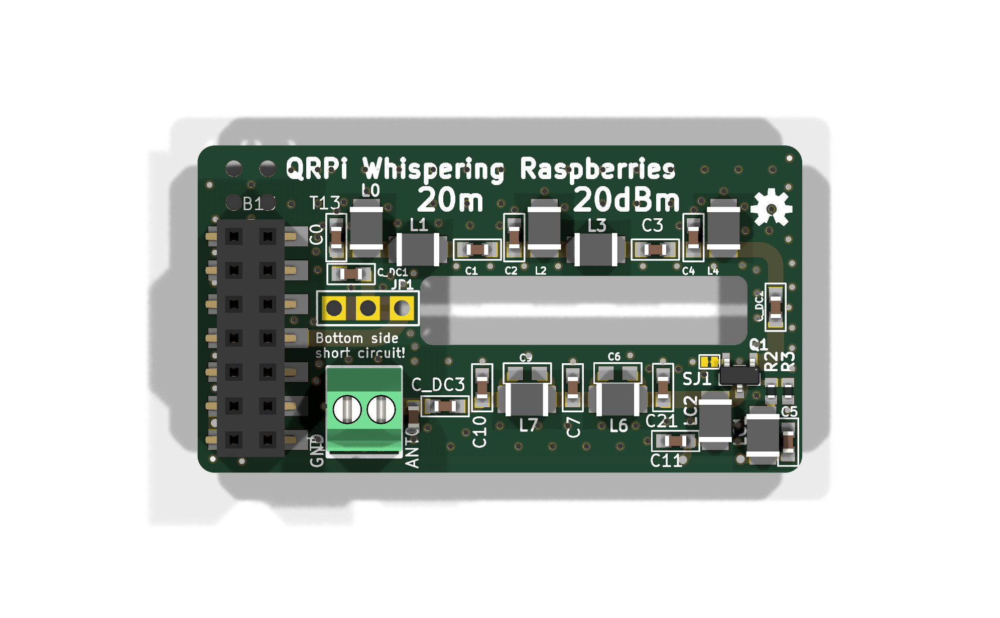
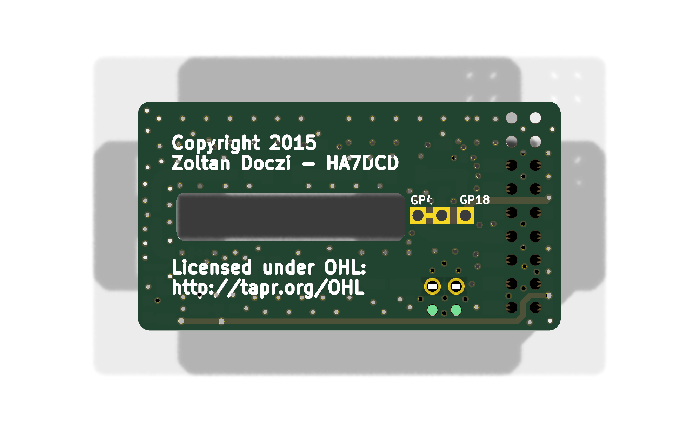
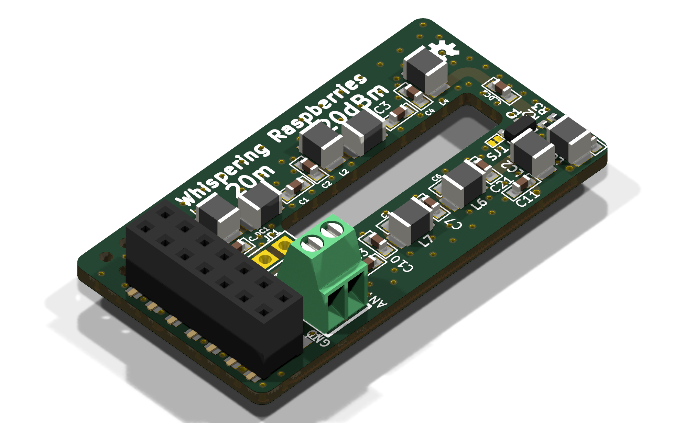

# QRPi – Whispering Raspberries: a Raspberry Pi QRP TX shield (20 m WSPR)

QRPi is a 20 m band, 20 dBm RF signal conditioner shield for the Raspberry Pi. It takes the RF square wave that the Pi generates on a GPIO pin and turns it into a clean, filtered QRP transmit signal: a MOSFET (MMBF170) stage followed by a multi-section low-pass filter. It was presented as a TAPR-DCC 2015 talk paper and was sold through TAPR and on Amazon.

This repository holds the board's original EAGLE design and manufacturing files (rev 1.6), and a KiCad 10 version of the same design.

*An earlier prototype (rev 1.1) on a Raspberry Pi model B, with a coax pigtail on the antenna terminal.*

## About the project (from [rfsparkling.com/qrpi](https://rfsparkling.com/qrpi/))

**QRPi - A Raspberry Pi QRP TX Shield Design, TAPR-DCC Talk paper 2015** ([PDF in this repo](docs/DCC2015-QRPI-HA7DCD.pdf))

QRPi is an RF signal conditioner shield for Raspberry Pi. Sourcing the RaspberryPi generated RF signal from GPIO4.

Right now existing only for the **20m band** for **14.0971 MHz** Later on will designed for other bands as well (10m in prototype).

In default GPIO4 mode can be used with [WsprryPi](https://github.com/JamesP6000/WsprryPi), [SSTV](https://github.com/JennyList/LanguageSpy/tree/master/RaspberryPi/rf/sstv), [CW](https://github.com/JamesP6000/PiCW), check manual here: [j.mp/tapr-qrpi](http://j.mp/tapr-qrpi) GPIO4 mode works with RPi 1 B, B+ and RPi 2 as well for WSPR mode.
When using in the **experimental GPIO18** mode (solder jumper selectable; SSB USB, LSB, NFM, WFM, AM with [qtcsdr](https://github.com/ha7ilm/qtcsdr) and [rpitx](https://github.com/F5OEO/rpitx)) it works only with RPi 2 right now (due to CPU demand)

However please be aware that QRPi was engineered and tested for GPIO4 pin, using WSPR modulation!
I'm adding GPIO18 option for **experimental mode only** to use with [qtcsdr](https://github.com/ha7ilm/qtcsdr) and [rpitx](https://github.com/F5OEO/rpitx)! By default the solder jumper is set for GPIO4 by short cut. As for VFO operation (CW signal) GPIO18 works nice but not yet tested comprehensively for other modulation yet, **please take care of this** in shake of RF spectrum emission! The QRPi shield is available at TAPR's webshop: <https://www.tapr.org/kits_20M-wspr-pi.html>

Now available at Amazon too: <https://www.amazon.com/Raspberry-QRP-Sheild-WSPR-Meters/dp/B01FWFKN40/>

Thanks for your interest!

73,
HA7DCD

Video: <https://www.youtube.com/watch?v=w-OTpw2Ai0k>

## The board in 3D (KiCad 10)

| Top | Bottom |
|---|---|
|  |  |

Two-layer board. The Raspberry Pi GPIO header pins pass through the board and into a 2x7 SMD female socket on the top side. The antenna is connected to a 2-pole Phoenix MPT 0,5/2-2,54 screw terminal. The GPIO4 / GPIO18 drive is selected on the bottom side: GPIO4 is shorted by default.

## Repository contents

| Path | What it is |
|---|---|
| `Eagle/20m_QRPi_1V6.sch`, `Eagle/20m_QRPi_1V6.brd` | Original EAGLE schematic and board (EAGLE 6.4 XML format) |
| `Eagle/20m_QRPi_1V6_sch.pdf`, `_top.pdf`, `_bot.pdf` | Schematic and board prints |
| `Eagle/20m_RPI_WSPR_TX_BOM_SMDmount.xlsx` | Bill of materials (SMD assembly) |
| `Eagle/CAM/20m_RPI_WSPR_TX_1v6.zip` | Original manufacturing files: Gerbers, Excellon drill files, PDFs |
| `KiCad/` | KiCad 10 project: schematic, PCB, project symbol and footprint libraries, design rules |
| `KiCad/3dmodels/` | STEP models used by the 3D view, from the KiCad standard library |
| `docs/` | TAPR-DCC 2015 paper, prototype photo, 3D renders |

## About the KiCad version

The KiCad project was converted from the EAGLE files with [Eagle Exhumer](https://github.com/z2labs/eagle-exhumer) and then checked against the EAGLE source and the original manufacturing files:

- Netlist of the schematic and of the board: identical to EAGLE (no shorts, no opens, no renamed nets)
- 33 parts, 78 pads, 169 holes, 144 vias: same position, side, rotation, value, size and drill as in EAGLE
- KiCad-generated Gerbers and drill files compared with the original EAGLE manufacturing files: copper (outside the polygon pours), solder mask, paste and all 169 drill holes match. Polygon pour fill differs by about 2.5 % because EAGLE and KiCad use different fill algorithms.
- Remaining DRC items are the same ones the original EAGLE design carries: the JP1 GPIO4/GPIO18 jumper's solder-mask opening intentionally exposes the GPIO4 track and ground.

Only the EAGLE drawing frame was removed (KiCad draws its own page frame). 3D models were added for 30 of 33 footprints; the solder jumpers JP1 and SJ1 and the OSHW logo have none.

## License

Copyright 2015 Zoltan Doczi - HA7DCD. The hardware design is licensed under the TAPR Open Hardware License (<http://tapr.org/OHL>).

The STEP models in `KiCad/3dmodels/` come from the KiCad library (CC-BY-SA 4.0 with an exception that allows their use in designs, see <https://www.kicad.org/libraries/license/>).